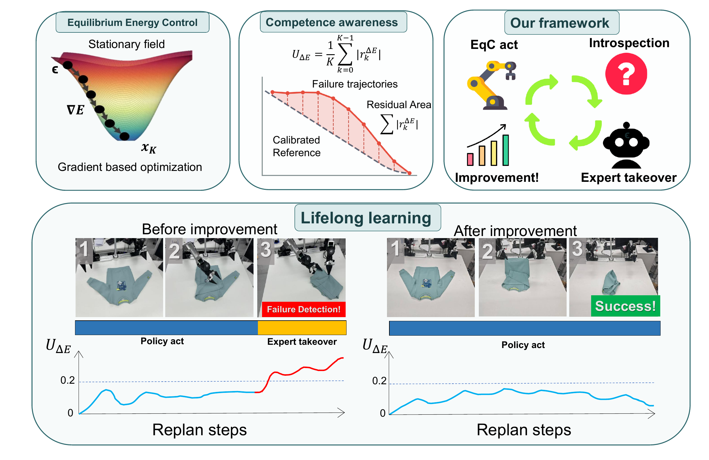

<h1 align="center">EqC: Equilibrium Energy Control for Introspective Lifelong Robot Learning</h1>

<p align="center">
  <a href="https://arxiv.org/abs/2610.18790"></a>
  <a href="https://equilibrium-energy-control.github.io/"></a>
  <a href="https://github.com/hrh6666/EqC"></a>
</p>



## News

- **2026.10** — EqC was accepted as a **Spotlight** at the CoRL 2026 Continually Self-Improving Robots Workshop!

## Citation

```bibtex
@misc{yang2026eqc,
  title={{EqC}: Equilibrium Energy Control for Introspective Lifelong Robot Learning},
  author={Haodong Yang and Runhan Huang and Bowen Zhang and Iofai Lei and
          Zunzhe Zhang and Xiangcheng Zhang and Shaoting Zhu and Linzhan Mou and
          Yicheng Liu and Hang Zhao},
  year={2026},
  eprint={2610.18790},
  archivePrefix={arXiv},
  primaryClass={cs.RO},
  url={https://arxiv.org/abs/2610.18790}
}
```
